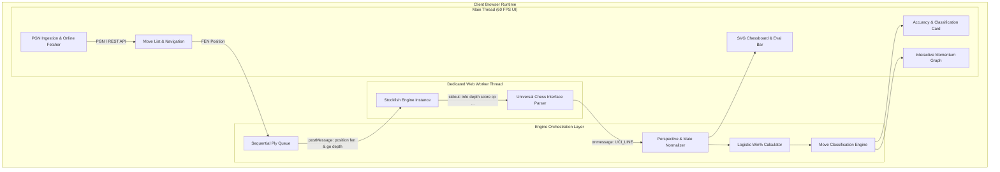

# Technical Case Study: ChessLens Architecture & System Design

> **An in-depth engineering breakdown of building a high-performance, browser-based chess game reviewer powered by Stockfish WebAssembly and non-blocking Web Worker concurrency.**

---

## 1. Executive Summary

Traditional online chess platforms (e.g. Chess.com, Lichess) evaluate player games by streaming moves to centralized backend server clusters. While effective, this architecture requires massive server infrastructure, exposes operators to linear hosting costs (\$0.01–\$0.05 per analyzed game), and requires users to transmit private game notations across the network.

**ChessLens** solves this problem by moving 100% of the computation into the visitor's browser:
- **Zero Cloud Costs:** \$0 server compute fees — the client's local CPU executes the chess engine.
- **Privacy-First:** Game PGNs never touch an external server or database.
- **Sub-100ms Startup:** Static edge hosting delivers the application instantly.
- **Explainable Mathematics:** Move classifications and accuracy scores are calculated using transparent logistic sigmoid models rather than black-box algorithms.

---

## 2. High-Level System Architecture



---

## 3. Concurrency & Web Worker Lifecycle

### The Problem: Main Thread Starvation
Stockfish relies on CPU-bound alpha-beta minimax search algorithms. If executed on the main JavaScript thread, evaluating a single chess position would lock the DOM event loop for 200–1000ms, resulting in dropped frames, unresponsive buttons, and browser freeze warnings.

### The Solution: Web Worker Isolation
ChessLens loads Stockfish inside an isolated **Web Worker** using WebAssembly:
1. The main thread instantiates the worker via an inlined `Blob` URL (`URL.createObjectURL(blob)`), eliminating cross-origin script restrictions and external asset loading failures.
2. The main thread communicates strictly through asynchronous message passing (`postMessage` and `onmessage`).

### Stale Response Race Conditions & Monotonic `jobId` Filtering
A classic race condition occurs when a user rapidly scrubs through moves (e.g., clicking Next $\to$ Next $\to$ Next). If evaluation $N$ finishes after evaluation $N+1$, an outdated score could overwrite the current board position.

ChessLens implements **monotonic job sequencing**:
```typescript
class EngineService {
  private currentJobId: number = 0;

  public evaluatePosition(fen: string, depth = 15): Promise<UciEvaluation> {
    const jobId = ++this.currentJobId; // Increment unique job token

    // Instruct active worker to halt previous search
    this.worker?.postMessage({ type: "UCI_COMMAND", command: "stop" });
    this.worker?.postMessage({ type: "UCI_COMMAND", command: `position fen ${fen}` });
    this.worker?.postMessage({ type: "UCI_COMMAND", command: `go depth ${depth}` });

    return new Promise((resolve) => {
      this.pendingJobs.set(jobId, { resolve });
    });
  }

  private handleWorkerMessage(data: UciMessage) {
    // If the message does not match current active jobId, silently discard it
    if (data.jobId !== this.currentJobId) return;
    // Process verified evaluation...
  }
}
```

---

## 4. Mathematical & Scoring Models

### 1. Centipawn Unboundedness & Logistic Sigmoid
Stockfish outputs evaluations in **centipawns** ($100\ cp = 1\ pawn$). However, centipawns are non-linear:
- An advantage shifting from $0$ to $+200$ cp changes the game from drawn to winning.
- An advantage shifting from $+1000$ to $+1200$ cp changes a completely winning game into a completely winning game.

To map centipawns into an intuitive win probability range ($0\% - 100\%$), ChessLens implements a **logistic sigmoid transformation**:

$$W(cp) = 50 + 50 \times \left( \frac{2}{1 + e^{-0.0035 \times cp}} - 1 \right)$$

```typescript
export function centipawnsToWinProbability(cp: number): number {
  const boundedCp = Math.max(-2000, Math.min(2000, cp));
  const winProbability = 50 + 50 * (2 / (1 + Math.exp(-0.0035 * boundedCp)) - 1);
  return Math.round(winProbability * 10) / 10;
}
```

#### Key Properties:
- $cp = 0 \implies W = 50.0\%$ (Equally balanced position).
- $cp = +300 \implies W \approx 74.0\%$ (Decisive piece advantage).
- $cp = +1000 \implies W \approx 96.9\%$ (Overwhelming winning advantage).
- Forced checkmate in $N$ moves ($Mate\ N$) $\implies 100.0\%$ ($+Mate$) or $0.0\%$ ($-Mate$).

### 2. Move Classification Engine
Moves are evaluated by calculating the delta between the engine's suggested best move win probability ($W_{best}$) and the played move's win probability ($W_{played}$):

$$\Delta W = W_{best} - W_{played}$$

| Move Category | Trigger Condition | Rationale |
|---|---|---|
| **Brilliant** 💎 | $\Delta W \le 0.5\%$ and Piece Sacrifice | Sacrificing material to maintain a decisive tactical edge. |
| **Best** ⭐ | $\Delta W \le 1.0\%$ | Top engine suggestion or functionally equivalent. |
| **Excellent** 👍 | $1.0\% < \Delta W \le 3.0\%$ | Strong practical move maintaining winning advantage. |
| **Good** ✔️ | $3.0\% < \Delta W \le 7.0\%$ | Playable move with minimal loss. |
| **Book** 📖 | Plies 1–6 within standard theory | Established opening book move. |
| **Inaccuracy** ⚠️ | $7.0\% < \Delta W \le 15.0\%$ | Slight concession of advantage. |
| **Mistake** ❓ | $15.0\% < \Delta W \le 25.0\%$ | Notable blunder giving opponent counterplay. |
| **Blunder** ❌ | $\Delta W > 25.0\%$ | Catastrophic drop in win equity. |
| **Miss** ⭕ | $W_{best} \ge 80\%$ and $W_{played} \le 50\%$ | Missed a concrete knockout blow. |

### 3. Player Accuracy Model
Overall game accuracy is calculated using an exponential decay error model:

$$\text{Accuracy} = 100 \times e^{-0.04 \times \overline{\Delta W}}$$

Where $\overline{\Delta W}$ is the player's average win probability drop per move. This bounds accuracy realistically between $10\%$ and $100\%$, matching human intuition.

---

## 5. Third-Party Platform Integrations

ChessLens integrates with public APIs from both major chess platforms without requiring API keys or backend proxies:

### 1. Lichess.org Public API
- **Endpoint:** `GET https://lichess.org/api/games/user/{username}?max=1&pgnInBody=true`
- **Header:** `Accept: application/x-chess-pgn`
- **Advantage:** Single-flight HTTP request returning clean PGN text directly.

### 2. Chess.com PubAPI
- **Architecture:** Two-stage archive traversal.
  1. `GET https://api.chess.com/pub/player/{username}/games/archives` $\to$ Returns array of monthly archive URLs.
  2. `GET {latest_archive_url}` $\to$ Returns JSON game list for the current month.
  3. Extract `games[games.length - 1].pgn`.

---

## 6. Reliability & Test Matrix

The codebase includes **44 automated unit tests** in Vitest:
- **`uci-protocol.test.ts` (8 tests):** UCI output parsing, mate string parsing (`mate -3`, `mate 5`), White score normalization.
- **`review-pipeline.test.ts` (15 tests):** Logistic sigmoid bounds, win delta calculations, classification thresholds, and player accuracy models.
- **`pgn-parser.test.ts` (5 tests):** Header metadata extraction, FEN history generation, and move list formatting.
- **`chess-edge-cases.test.ts` (10 tests):**
  - Pawn underpromotions (`=N`, `=R`, `=B`).
  - En passant captures and correct removal of captured pawns.
  - Castling rights preservation across king moves.
  - Stalemate trap identification.
  - Malformed and corrupt PGN sanitization.
  - 100-ply marathon scalability benchmark (<150ms).
- **`chess-api.test.ts` (6 tests):** Lichess and Chess.com mock API responses, 404 user handling, and empty archive edge cases.

---

## 7. Interview Q&A Cheatsheet

### Q1: Why did you build ChessLens as an offline-first client application rather than using a server-side engine cluster?
> *"Running Stockfish on cloud servers incurs linear costs: at scale, running a 16-ply depth search on thousands of concurrent games would cost hundreds of dollars in compute per month. By compiling Stockfish to WebAssembly and running it client-side in an isolated Web Worker, our compute cost is exactly \$0.00, our application scales infinitely, and user game data is 100% private."*

### Q2: How did you ensure the Stockfish engine didn't freeze the user interface?
> *"The browser main thread handles rendering and DOM events at 60 FPS. If Stockfish ran on the main thread, its alpha-beta minimax tree search would block the JavaScript event loop. We spawned Stockfish inside a dedicated Web Worker via an inlined Blob. Communications occur purely via asynchronous `postMessage` calls using the UCI protocol."*

### Q3: How did you handle out-of-order responses when users rapidly navigate through moves?
> *"We assigned an incremental monotonic `jobId` to every evaluation request and sent a `stop` command to cancel previous searches. When the Web Worker emits evaluation lines, we check if the message's `jobId` matches the currently active `jobId`. If it doesn't, we discard it. This guarantees that stale asynchronous engine responses never overwrite the active board position."*

### Q4: Why can't you just use centipawns directly to classify moves?
> *"Centipawns are unbounded and non-linear in practical play. Losing 200 centipawns when the evaluation is +1.0 (dropping from winning to equal) completely flips the game outcome, whereas losing 200 centipawns when the evaluation is +9.0 leaves White completely winning. By mapping centipawns through a logistic sigmoid curve ($W(cp)$), we calculate move quality based on $\Delta Win\%$, accurately reflecting human game impact."*
